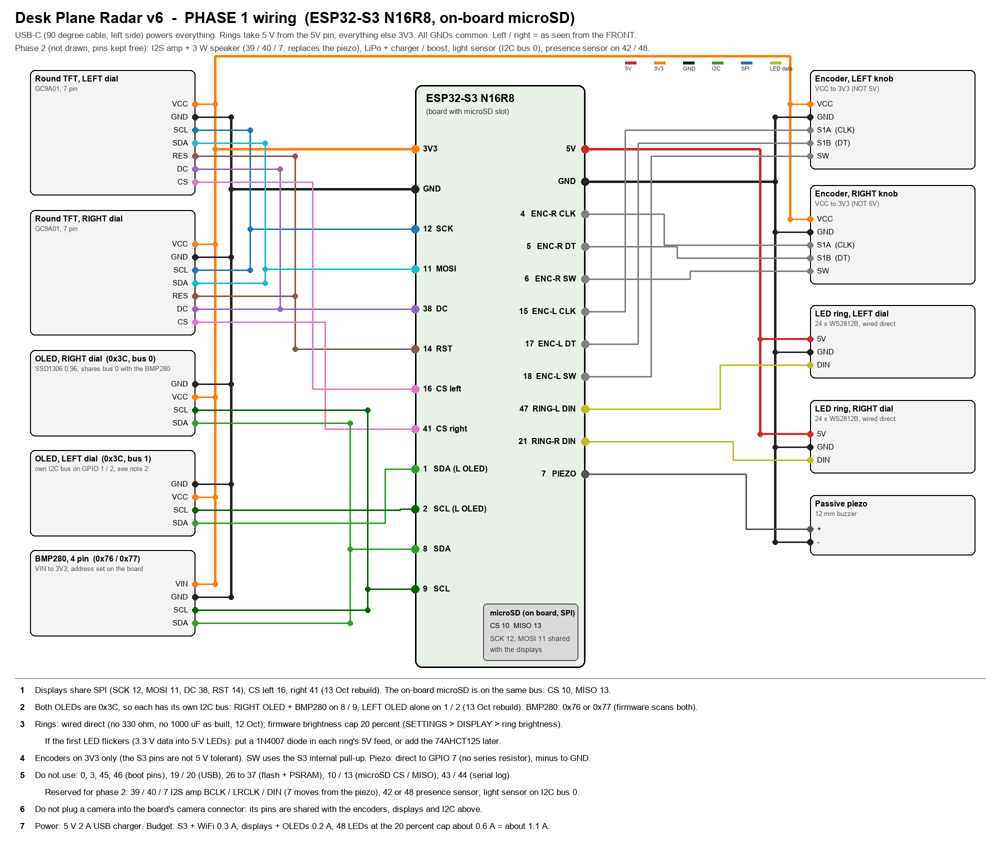

# Desk Plane Radar

A twin-dial desk gadget built around an ESP32-S3: a live aircraft radar for your home airport on the left dial, a detail card (airline logo, flight, route, type, runway side-view) on the right, two small OLEDs below them, two addressable LED rings around them, two knobs. It also does a clock with 17 faces, weather and air quality, your calendar (via a small Mac helper), a Pomodoro timer with a focus log, markets and news, all configured from a web page on the device.

## What it does

| App | Left dial | Right dial |
|---|---|---|
| RADAR | live ADS-B traffic around the home airport, sweep, trails, arrivals / departures | the subject aircraft: logo, flight, route, type, a side view of the approach or departure |
| ARRIVALS / APPROACH | airport board, glideslope side view | board for another airport, METAR / TAF |
| CLOCK | 17 faces (analog, flip, nixie, words, rings, night sky, ...) | weather, agenda, world time, sun and moon or next arrivals (your choice) |
| WEATHER | now, 3 days, 24 h history, AQI, indoor sensor | next 12 h |
| POMODORO | sessions with presets, task name, daily goal | countdown and progress, stats |
| AGENDA | today's meetings from the Mac (Apple Calendar) with chimes and an on-air light | now / next |
| MARKETS, NEWS, MEDIA | quotes, headlines, Mac media keys | |
| SETTINGS | everything, on the device (press both knobs) | |

The LED rings carry the radar sweep and aircraft bearings, Pomodoro progress, meeting countdowns, a sky pointer when an aircraft passes overhead, and the clock's hands or seconds.

## Hardware

| Part | Notes |
|---|---|
| ESP32-S3 N16R8 dev board with microSD slot | 16 MB flash, 8 MB PSRAM |
| 2 x GC9A01 1.28" round TFT (240 x 240, 7 pin SPI) | shared SPI, separate CS |
| 2 x SSD1306 0.96" OLED (128 x 64, yellow / blue) | one per I2C bus (both are 0x3C) |
| 2 x 24-LED WS2812B ring | 5 V from the board |
| 2 x KY-040 rotary encoder with push button | 3V3 |
| BMP280 (or BME280) | indoor temperature and pressure |
| passive piezo | chimes |
| microSD card | airline logos, backups |

Full list with sources: [docs/PARTS_LIST.md](docs/PARTS_LIST.md). Wiring: [docs/images/wiring_v6_phase1.png](docs/images/wiring_v6_phase1.png) (everything) and [docs/images/wiring_v6_panel.png](docs/images/wiring_v6_panel.png) (the front panel only, for soldering). Pin map and bring-up order: [docs/V6_FIRMWARE_BRIEF.md](docs/V6_FIRMWARE_BRIEF.md). Assembly: [docs/BUILD_GUIDE.md](docs/BUILD_GUIDE.md).

## Case

`case_v6/stl/` holds the printable parts (body, cover, carrier, bezel rings, knobs, clamp plate), sized for a Bambu Lab A1 Mini bed. The case is generated from `case_v6/make_case_v6.py`; `make case` regenerates the STLs and runs the clearance checks.

## Firmware

Arduino sketch, built with arduino-cli through the Makefile (macOS / Linux).

| Step | Command |
|---|---|
| tools and libraries, once | `brew install arduino-cli` then `make deps` |
| credentials | copy `firmware/desk_plane_radar_v6/secrets.example.h` to `secrets.h`: WiFi, optional OpenSky account, optional focus-log URL |
| your place | copy `config_local.example.h` to `config_local.h`: house coordinates, time zone, name, mDNS host, `PANEL_SWAP` if your panel is wired mirrored |
| compile | `make compile6` |
| flash over USB | `make upload6` |
| flash over WiFi | `make ota6` (host `deskradar6.local`) |
| logs | `make log6 SECS=60` or `make weblog6` |

The home airport and the airport table live in the sketch's USER CONFIG block (`AIRPORTS[]`, first entry = default home). Everything else is set from the device (SETTINGS) or the web page at `http://deskradar6.local`.

### Optional pieces

| Piece | Purpose |
|---|---|
| `tools/mac_helper/` | a small macOS LaunchAgent that posts your calendar, mic / camera state and now-playing info to the device, and takes volume / mute / media commands back. `install.sh` builds and installs it |
| `google/focus_log.gs` | Google Apps Script that logs Pomodoro sessions to a sheet and returns stats |
| `tools/make_airline_logos.py` | renders airline logos for the SD card (`/deskradar/logos/<IATA>.lgo`) from image files you supply; `tools/sd_upload.sh` uploads them over WiFi |
| `tools/webpage/index.html` | source of the device's web page (embedded in the sketch) |
| `firmware/sd_probe/` | finds the microSD wiring of an unknown board |

## Data sources

adsb.lol, adsb.fi, airplanes.live and OpenSky (aircraft), adsbdb.com (routes), hexdb.io (types), Open-Meteo (weather, air quality), aviationweather.gov (METAR / TAF / SIGMET), USGS (quakes), Yahoo Finance (quotes), BBC and The Hindu RSS (news), wheretheiss.at (ISS). All free tiers; keep the poll intervals as shipped and respect their terms.

## Credits

Poppins (OFL) and DejaVu fonts; Arduino_GFX, Adafruit GFX / SSD1306 / NeoPixel / BMP280, ArduinoJson, ESP32Encoder, WiFiManager.

## Licence

MIT for the firmware and tools (see LICENSE). The case model is published on MakerWorld under its own licence.
